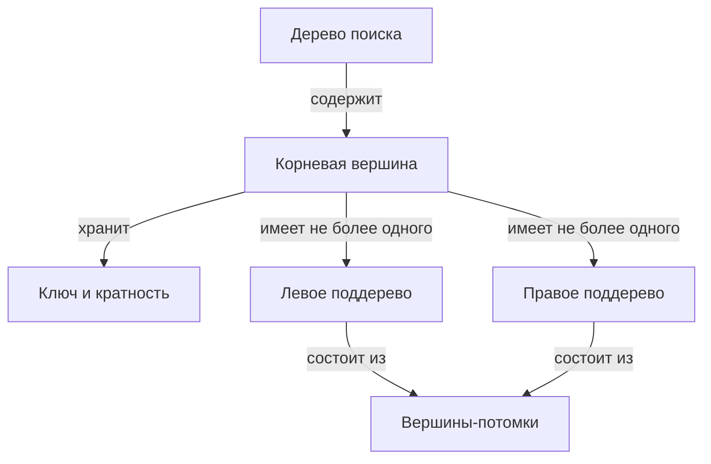
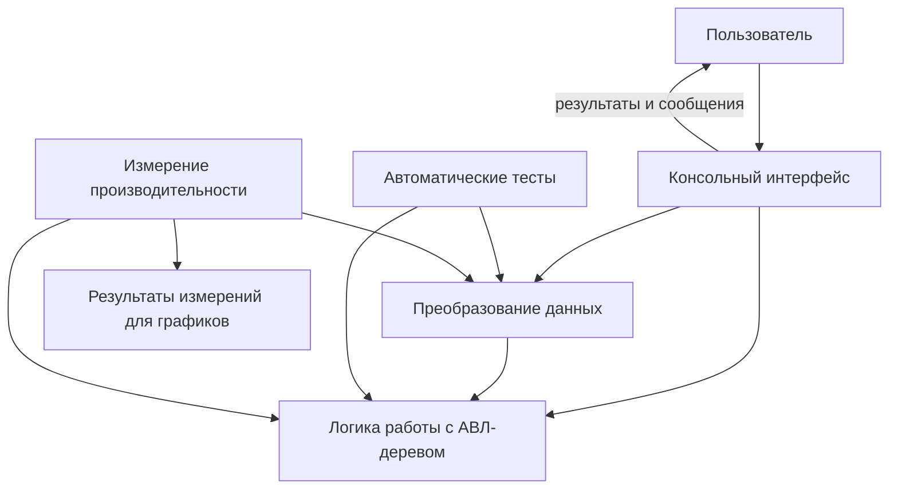

# Дизайн системы работы с АВЛ-деревом

## 1. Постановка задачи

### 1.1. Идея работы

Цель работы — спроектировать систему для хранения и обработки упорядоченных данных на основе **самобалансирующегося бинарного дерева поиска (АВЛ-дерева)**.

Система должна позволять добавлять, находить и удалять значения, получать сведения о дереве, выделять поддеревья и выполнять преобразования над набором элементов. При изменении состава дерева необходимо сохранять его упорядоченность и балансировку.

Приложение предусматривает интерактивную работу через консоль, автоматическую проверку корректности операций и исследование их производительности.

### 1.2. Область применения

Такая система представляет общий класс решений для работы с **упорядоченными наборами данных в оперативной памяти**, когда важны быстрый поиск и динамическое изменение содержимого. Подобные структуры могут служить основой для индексирования, хранения отсортированных значений, учёта повторяющихся элементов и обработки данных с сохранением порядка.

## 2. Сущности прикладной задачи

### 2.1. Основные сущности

| Сущность | Описание |
| --- | --- |
| **Значение (ключ)** | Данные, которые хранятся в дереве и могут сравниваться между собой. В пользовательском сценарии используются целые числа. |
| **Вершина дерева** | Элемент логической структуры дерева, связанный с одним ключом и его кратностью. |
| **Дерево поиска** | Иерархическая структура из вершин, в которой ключи левого поддерева меньше ключа родительской вершины, а правого — больше. |
| **Поддерево** | Часть дерева, состоящая из выбранной вершины и всех её потомков. |

Для одинаковых значений учитывается **кратность**: несколько вхождений одного ключа логически существуют в коллекции, не создавая новых вершин с тем же ключом.

### 2.2. Связи сущностей

Для каждой вершины выполняются следующие отношения и ограничения:

- Левое поддерево содержит только ключи, меньшие ключа текущей вершины; правое — только большие.
- У вершины не более двух непосредственных потомков; все вершины, кроме корневой, имеют одного родителя.
- Одно из поддеревьев может отсутствовать.
- Для АВЛ-дерева высоты левого и правого поддеревьев каждой вершины отличаются не более чем на единицу.

## 3. Архитектура системы

### 3.1. Высокоуровневые компоненты

| Компонент | Ответственность |
| --- | --- |
| **Консольный интерфейс (CLI)** | Отображение доступных действий, получение пользовательского ввода, показ результатов и сообщений об ошибках. |
| **Логика работы с деревом** | Хранение упорядоченных значений, соблюдение инвариантов дерева поиска и АВЛ-балансировки, выполнение операций над элементами и поддеревьями. |
| **Преобразование данных** | Представление дерева в текстовом виде, построение дерева из последовательности значений, операции `map`, `where` и `reduce`. |
| **Автоматические тесты** | Проверка ожидаемого поведения дерева, корректности результатов операций и пограничных случаев. |
| **Измерение производительности** | Проведение серий измерений на наборах данных разных размеров. |

### 3.2. Связи между компонентами

Интерфейс, автоматические тесты и измерения производительности являются **разными способами использования одной предметной логики**. Они не должны определять правила хранения элементов или поддержания баланса дерева.

### 3.3. Ключевые проектные решения и алгоритмы

**Структура данных.** Выбрано бинарное дерево поиска с АВЛ-балансировкой. Поддерживается хранение повторяющихся ключей посредством учёта их кратности. Общее число элементов учитывает повторения.

**Поиск.** На каждой вершине искомый ключ сравнивается с текущим: поиск продолжается в левом либо правом поддереве. Отсутствие подходящей вершины означает, что значение не найдено.

**Вставка.** Новый ключ размещается в соответствии с порядком дерева поиска. Для существующего ключа увеличивается кратность. После изменения структуры при необходимости восстанавливается баланс.

**Удаление.** При наличии нескольких вхождений ключа удаляется одно вхождение. Если удаляется вершина, сохраняется порядок дерева поиска; затем восстанавливается баланс.

**Балансировка.** Для восстановления свойства АВЛ используются локальные перестройки — одиночные и двойные повороты. Это не требует полной перестройки дерева после каждой операции.

**Обход.** Для текстового представления используется обход «корень — левое поддерево — правое поддерево» (КЛП). Для преобразований и агрегирования предусмотрен последовательный обход элементов дерева с учётом их кратности.

**Преобразования.** `map` формирует дерево из преобразованных значений; `where` — из значений, удовлетворяющих условию; `reduce` сводит последовательность элементов к одному результату. Исходное дерево при `map` и `where` не изменяется.

**Поддеревья.** Предусмотрено выделение набора элементов, принадлежащих поддереву выбранной вершины, и проверка соответствия заданного дерева части исходного дерева. При проверке структуры учитываются значения, их кратности и связи между вершинами.

**Оценка сложности.** Благодаря поддержанию АВЛ-баланса поиск, вставка и удаление одного значения имеют оценку `O(log n)` по числу различных ключей; обход всех элементов требует `O(n)` времени по числу вхождений. Операции, создающие новые деревья, дополнительно включают затраты на размещение значений в результирующей структуре.

## 4. Функциональные требования

### 4.1. Требования к дереву

| № | Требование | Особые сценарии |
| --- | --- | --- |
| F1 | Создавать пустое дерево или дерево с начальным значением. | Пустое дерево допускается. |
| F2 | Добавлять значение. | Повторное значение увеличивает его кратность. |
| F3 | Проверять наличие значения. | Если значение отсутствует, возвращается отрицательный результат. |
| F4 | Удалять одно вхождение значения. | Отсутствующий ключ не изменяет дерево; при кратности более 1 вершина сохраняется. |
| F5 | Автоматически поддерживать АВЛ-баланс после изменений структуры. | Упорядоченность должна сохраняться при всех вариантах вставки и удаления. |
| F6 | Получать значение корня и число элементов. | Для пустого дерева запрос корня обрабатывается как особый случай. |
| F7 | Проверять, пусто ли дерево, и очищать его. | После очистки число элементов равно нулю. |
| F8 | Получать текстовое представление дерева в порядке КЛП. | Пустое дерево представляется пустой последовательностью. |
| F9 | Создавать дерево из текстовой последовательности значений. | Некорректные элементы входной строки должны приводить к сообщению об ошибке. |
| F10 | Выделять поддерево по заданному значению корня. | Если ключ не найден, результат должен явно отражать отсутствие поддерева. |
| F11 | Проверять вхождение заданного поддерева в исходное дерево. | Учитываются значения, кратности и структура. |
| F12 | Применять `map`, `where` и `reduce`. | Обрабатываются в том числе пустое дерево и повторяющиеся значения. |
| F13 | Поддерживать независимое копирование и перенос содержимого дерева. | Изменение копии не должно изменять исходное дерево. |

### 4.2. Требования к пользовательскому интерфейсу

- Предоставлять меню для добавления, удаления, поиска, просмотра, очистки дерева и получения его характеристик.
- Предоставлять действия для выделения/проверки поддеревьев и выполнения `map`, `where`, `reduce`.
- Позволять автоматически заполнять дерево случайными значениями в заданном диапазоне.
- Позволять создавать дерево по последовательности чисел, введённой пользователем.
- Проверять корректность вводимых данных и выводить понятные сообщения при ошибках.
- Позволять завершить программу по выбору пользователя.

### 4.3. Требования к тестированию и оценке производительности

- Проверять операции на пустом дереве, дереве с одной вершиной, повторяющихся ключах и различных формах дерева.
- Проверять сохранение упорядоченности и балансировки после вставки и удаления.
- Проверять независимость копирования и корректность перемещения.
- Измерять длительность основных операций на наборах данных разных размеров.

---