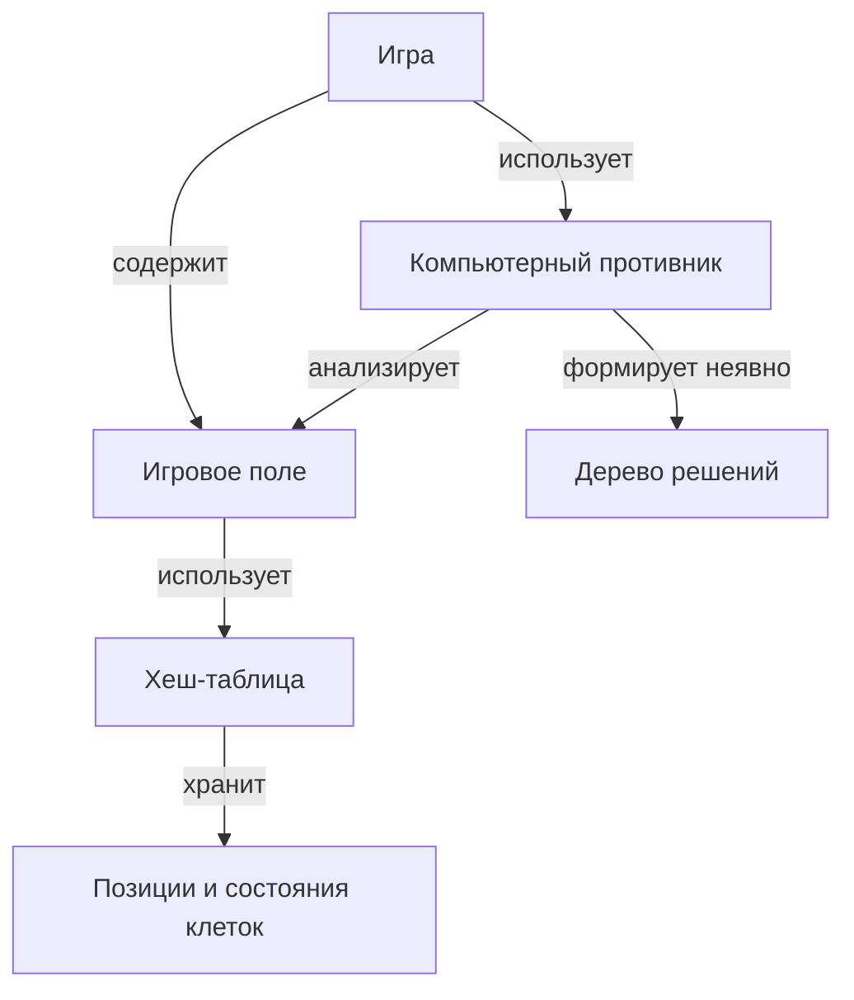
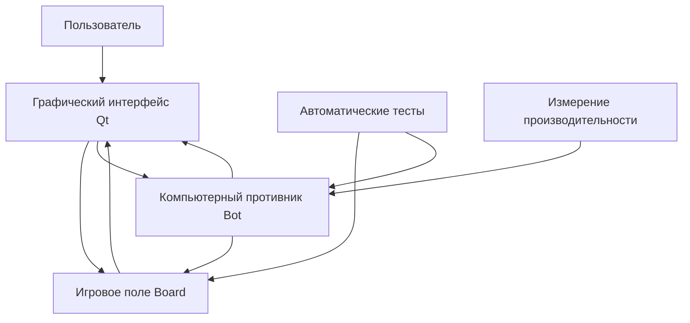

# Дизайн игры «Крестики-нолики»

## 1. Постановка задачи

### 1.1. Идея работы

Цель работы — разработать систему для игры в «Крестики-нолики» против компьютерного противника на двумерном игровом поле с использованием алгоритма минимакс.

Система должна обеспечивать хранение игрового состояния, выполнение ходов, проверку победы и выбор оптимального хода компьютера.

Для поиска ходов предполагается использование двух алгоритмов: обычного минимакса и минимакса с альфа-бета-отсечением.

Для хранения игрового поля используется хеш-таблица с разрешением коллизий методом цепочек.

### 1.2. Область применения

Разработка игровых систем с искусственным интеллектом, исследование алгоритмов поиска решений, оценивание игровых состояний и сравнение эффективности различных методов перебора.

## 2. Основные сущности

### 2.1. Сущности

- **Игровое поле (`Board`)** — структура, содержащая информацию о расположении крестиков и ноликов и обеспечивающая выполнение игровых операций.
- **Позиция (`Position`)** — координаты клетки игрового поля, задаваемые двумя целыми числами.
- **Клетка (`Cell`)** — состояние игровой позиции: пустая, крестик или нолик.
- **Компьютерный противник (`Bot`)** — компонент(ботяра), осуществляющий выбор хода на основании анализа игровой ситуации.
- **Хеш-таблица (`HashTable`)** — структура данных для хранения занятых позиций и возможных ходов.
- **Дерево решений** — неявная структура, формируемая рекурсивным перебором возможных последовательностей ходов.

Для хранения хеш-таблицы используется массив корзин, каждая из которых содержит список пар «ключ — значение».

### 2.2. Связи между сущностями

Игровое поле хранит информацию о занятых клетках и доступных ходах. Компьютерный противник анализирует состояние поля и выбирает наиболее выгодный ход.

Дерево решений не хранится как отдельная структура данных, а формируется в процессе рекурсивного выполнения алгоритма минимакс.

## 3. Архитектура системы

### 3.1. Основные компоненты

Предполагается разделение системы на следующие компоненты:

1. **Логика игрового поля** — хранение позиций, выполнение и отмена ходов, проверка допустимости ходов и определение победителя.
2. **Логика компьютерного противника** — оценивание игровых ситуаций и поиск оптимального хода с помощью минимакса.
3. **Графический интерфейс** — отображение игрового поля, обработка действий пользователя и взаимодействие с ботом.
4. **Автоматические тесты** — проверка корректности структур данных, игровых операций и алгоритмов поиска оптимального хода.
5. **Измерение производительности** — сравнение времени работы обычного минимакса и минимакса с альфа-бета-отсечением.

### 3.2. Связи между компонентами

Графический интерфейс, компьютерный противник, тестирование и измерение производительности используют общую игровую логику.

### 3.3. Основные алгоритмы и решения

**Структура данных:** для хранения игрового поля выбрана хеш-таблица с разрешением коллизий методом цепочек. В таблице сохраняются только занятые клетки, что позволяет работать с игровым полем без заранее заданных границ.

**Хеширование:** координаты клетки преобразуются в хеш-значение, на основании которого определяется индекс корзины. При совпадении индексов разные элементы сохраняются в одном списке.

**Формирование возможных ходов:** рассматриваются свободные клетки, расположенные рядом с уже занятыми позициями. Это позволяет ограничить число анализируемых ходов на бесконечном поле.

**Выполнение хода:** перед добавлением фигуры проверяется, что выбранная клетка свободна. После выполнения хода обновляются игровое состояние и информация о возможных ходах.

**Проверка победы:** после каждого хода проверяется наличие пяти одинаковых фигур подряд по горизонтали, вертикали и двум диагональным направлениям.

**Оценивание игровой ситуации:** позиции оцениваются на основании количества последовательных фигур и числа открытых концов соответствующих комбинаций. При этом учитываются как собственные комбинации компьютера, так и угрозы со стороны противника.

**Минимакс:** рекурсивный перебор возможных ходов на ограниченную глубину. Компьютер выбирает ход с максимальной оценкой, предполагая, что противник стремится минимизировать результат.

**Альфа-бета-отсечение:** оптимизация минимакса, позволяющая прекращать исследование ветвей дерева решений, которые не способны повлиять на окончательный выбор.

**Ограничение глубины:** поиск выполняется на заданную глубину, после достижения которой используется оценочная функция. Сложность перебора в общем случае экспоненциально зависит от глубины поиска.

**Сравнение производительности:** оба алгоритма запускаются на одинаковых игровых позициях с одинаковой глубиной поиска. Время выполнения измеряется с помощью `std::chrono`.

## 4. Функциональные требования

Система должна поддерживать:

- **Создание игрового поля** — начальное состояние не содержит занятых клеток.
- **Бесконечное игровое поле** — игровые координаты не ограничиваются фиксированным размером массива.
- **Хранение игровых позиций** — с использованием хеш-таблицы и разрешением коллизий через списки.
- **Выполнение ходов** — добавление крестика или нолика на свободную позицию.
- **Отмену ходов** — восстановление состояния поля при переборе вариантов компьютерным противником.
- **Проверку занятости клетки** — получение информации о возможности выполнения хода.
- **Получение списка возможных ходов** — формирование набора доступных для анализа позиций.
- **Определение победителя** — проверку наличия пяти одинаковых фигур подряд.
- **Поиск оптимального хода** — с использованием обычного минимакса.
- **Альфа-бета-отсечение** — оптимизированный поиск без изменения правил игры и оценочной функции.
- **Настройку глубины поиска** — возможность изменения количества рассматриваемых уровней дерева решений.
- **Графическое отображение поля** — отрисовку сетки, крестиков и ноликов средствами Qt.
- **Управление мышью** — выполнение ходов левой кнопкой и перемещение видимой области поля при удержании правой кнопки.
- **Отображение состояния игры** — указание очередности ходов, процесса вычисления хода компьютером и результата партии.
- **Измерение времени выполнения** — получение продолжительности поиска хода выбранным алгоритмом.
- **Сравнение алгоритмов** — исследование времени работы на одинаковых игровых позициях при одинаковой глубине поиска.
- **Автоматическое тестирование** — проверку основных операций хеш-таблицы, игрового поля, определения победителя и алгоритмов поиска, включая граничные случаи.

При выполнении алгоритмов поиска исходное игровое состояние должно сохраняться: все временно выполненные ходы необходимо отменять после завершения анализа соответствующего варианта.