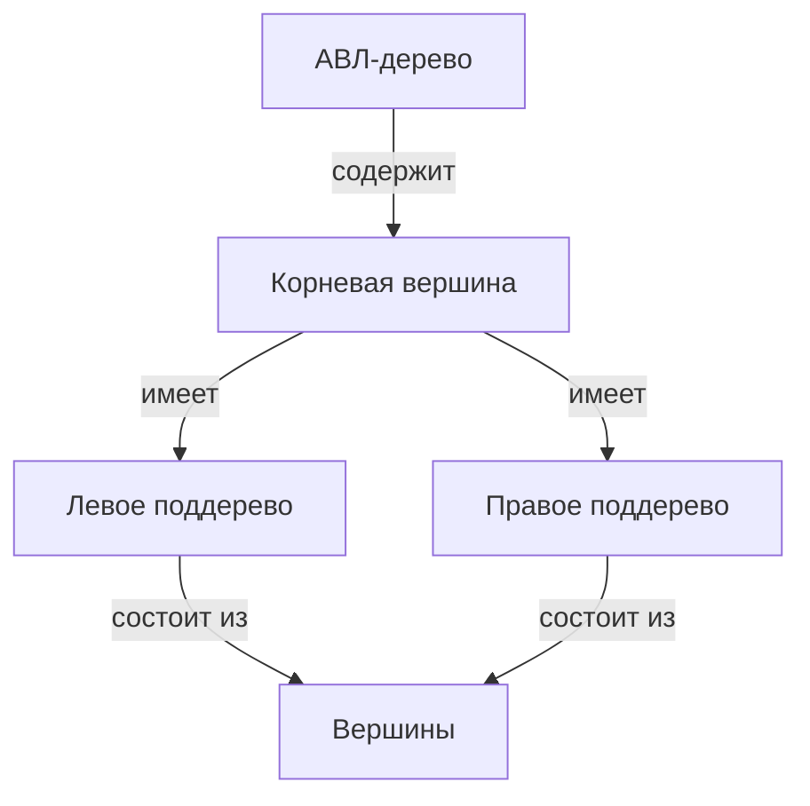
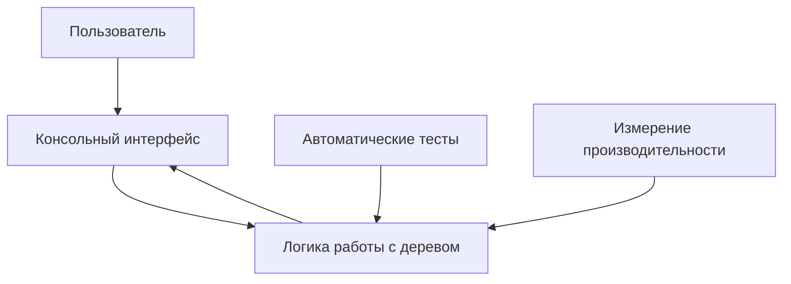

# Дизайн системы работы с АВЛ-деревом

## 1. Постановка задачи

### 1.1. Идея работы

Цель работы — разработать систему для хранения и обработки упорядоченных данных на основе самобалансирующегося бинарного дерева поиска (АВЛ-дерева).

Система должна обеспечивать эффективное добавление, поиск и удаление элементов, поддерживать работу с поддеревьями и преобразования данных.

Для основных операций поиска, вставки и удаления предполагается временная сложность O(log n).

### 1.2. Область применения

Хранение упорядоченных наборов данных, организация быстрого поиска, индексирование и обработка коллекций с повторяющимися значениями.

## 2. Основные сущности

### 2.1. Сущности

- **АВЛ-дерево** — бинарное дерево поиска, в котором разность высот поддеревьев каждой вершины не превышает единицы.
- **Вершина** — элемент дерева, содержащий значение, его кратность и связи с другими вершинами.
- **Поддерево** — часть дерева, состоящая из выбранной вершины и всех её потомков.

Повторяющиеся значения хранятся в одной вершине с использованием счётчика кратности.

### 2.2. Связи между сущностями

Каждая вершина может иметь не более двух потомков. Значения в левом поддереве меньше значения родительской вершины, а в правом — больше в соответствии с выбранным правилом сравнения.

## 3. Архитектура системы

### 3.1. Основные компоненты

Предполагается разделение системы на следующие компоненты:

1. **Логика работы с деревом** — хранение значений, выполнение основных операций и поддержание АВЛ-баланса.
2. **Консольный интерфейс** — взаимодействие с пользователем и отображение результатов.
3. **Автоматические тесты** — проверка корректности операций и свойств дерева.
4. **Измерение производительности** — исследование времени выполнения операций при разном количестве элементов.

### 3.2. Связи между компонентами

Консольный интерфейс, тесты и измерение производительности используют общую логику дерева.

### 3.3. Основные алгоритмы и решения

**Структура данных:** для хранения элементов выбрано АВЛ-дерево с поддержкой повторяющихся значений. Сравнение элементов должно допускать использование пользовательского правила.

**Поиск:** последовательное сравнение искомого значения с текущей вершиной и переход в соответствующее поддерево.

**Вставка:** добавление нового значения по правилам бинарного дерева поиска. При повторении значения увеличивается его кратность.

**Удаление:** удаление одного вхождения значения с сохранением упорядоченности дерева.

**Балансировка:** пересчёт высот и применение одиночных либо двойных поворотов при нарушении АВЛ-баланса.

**Обход:** для представления дерева используется порядок КЛП (корень — левое — правое).

**Преобразования:** обход дерева с применением пользовательской функции. Операции `map` и `where` создают новые деревья, не изменяя исходное, а `reduce` сводит элементы к одному результату.

**Работа с поддеревьями:** выделение поддерева по значению его корня и проверка соответствия заданного дерева части исходного дерева.

## 4. Функциональные требования

Система должна поддерживать:

- **Создание дерева** — пустого или с начальным значением.
- **Добавление элементов** — при повторении значения увеличивается его кратность.
- **Поиск элементов** — если значение отсутствует, возвращается отрицательный результат.
- **Удаление элементов** — удаляется одно вхождение; если значение отсутствует, дерево не изменяется.
- **Поддержание АВЛ-баланса** — после изменения структуры дерево должно оставаться сбалансированным.
- **Получение информации** — значение корня, количество элементов, проверка на пустоту.
- **Очистку дерева** — после очистки дерево становится пустым.
- **Копирование и перемещение дерева**.
- **Обход КЛП** — для пустого дерева возвращается пустая последовательность.
- **Преобразование дерева в строку и обратно** — некорректный ввод должен обрабатываться как ошибка.
- **Получение поддерева** — если значение не найдено, возвращается пустое дерево.
- **Проверку вхождения поддерева** — с учётом структуры, значений и их кратности.
- **Операции `map`, `where`, `reduce`** — должны корректно работать в том числе с пустыми деревьями и повторяющимися значениями.
- **Автоматическое тестирование** основных операций и особых случаев.
- **Измерение времени выполнения** операций для исследования производительности.